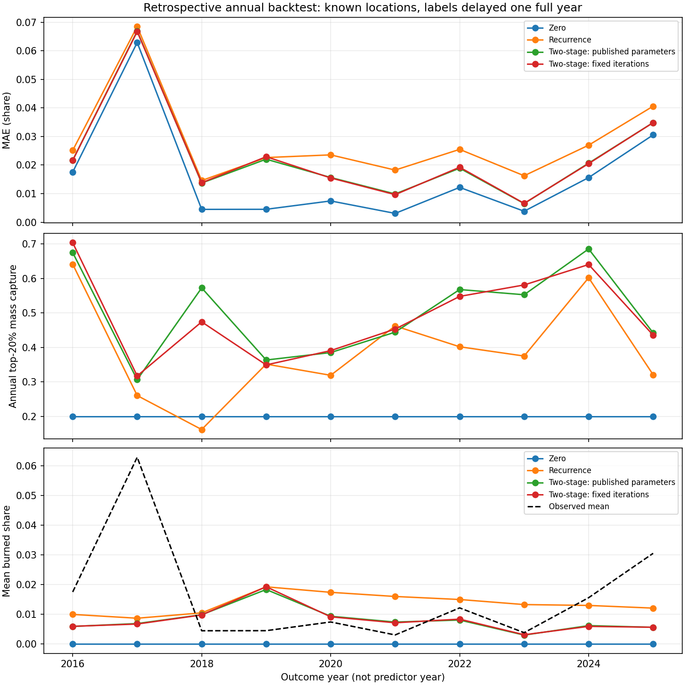

# Forecast review experiment record

Completed 24 October 2026 on `codex/forecast-reliability-review`. The full
interpretation is in [the review](../../../docs/forecast_reliability_review.md).
This is retrospective research on revised datasets and reused development
years, not a new untouched test. No model replacement was made.

## Design and results

- Ten expanding annual folds, outcomes 2016–2025; 89,112 cells per year.
- Issue 31 December Y−1, input cutoff 30 December Y−1; training labels end Y−2.
- Seven cell methods, two freshly fitted two-stage variants per fold.
- Separate national area-weighted annual target and simple aggregate forecasts.
- Paired whole-country year-block uncertainty; no future prediction intervals.
- Runtime: 281.3 seconds in the recorded environment; no training subsampling.

| File | Content |
|---|---|
| `protocol.json` | Specification written before fits; seeds, dates, target and limitations. |
| `frozen_verification.json` | Saved models reproduce frozen predictions; recalculated MAE/RMSE match recorded JSON. |
| `frozen_audit.csv` | Recomputed original pooled and outcome-year results, including zero baseline. |
| `backtest_by_year.csv` | Every annual error, positive/zero diagnostic and explicit ranking metric. |
| `backtest_summary.csv` | Ten-year error summaries and separate annual-budget captures. |
| `folds.csv` | Training cutoffs, row counts and fitted stage iterations. |
| `differences.csv` | Absolute and relative cell-model differences; negative error difference is better. |
| `uncertainty.csv` | Paired 4,000-resample intervals, block lengths 1/2/3 years. |
| `frozen_uncertainty.csv` | Original three-year sensitivity diagnostics; insufficient for strong inference. |
| `national_observed.csv` | Annual area-weighted national target and land/burned areas in square metres. |
| `aggregate_by_year.csv` | Every national target/prediction for identical outcome years. |
| `aggregate_summary.csv` | Separate national MAE, RMSE and bias. |
| `annual_results.png` | MAE, annual ranking and observed/predicted mean by outcome year. |
| `run_manifest.json` | Input, result, code and model hashes; versions and preservation checks. |
| `verification.json` | Final focused/standard test results and repeated-run equality checks. |

The local, Git-ignored directory `data/processed/research/forecast_review_v2/`
holds ten Parquet prediction tables, twenty fitted model artifacts and the
preservation inventory. No raw or per-cell dataset is added to Git. Summary
tables, this record, the protocol and the diagnostic chart are review evidence.



## Verification and preservation

The successful run verified **87 existing analytical/publication files** were
unchanged, including published model files, predictions, score manifests,
GeoPackages, web-map data, QGIS files, presentation and historical reports.
Input/result/code hashes are recorded in the manifest. Numerical predictions
for all **891,120 rows and seven methods** match the first execution exactly.
Git preserves research-result file bytes without line-ending conversion so
the recorded SHA-256 values still match after checkout on another platform.

The first execution completed every fit but stopped at its final preservation
check because the existing operational-preflight test rewrote
`forecast_2026_preflight.json` with a new `checked_utc` timestamp. This is a
volatile readiness log; the model and all published predictions were unchanged.
The test now writes that report inside its temporary directory. The successful
repeat explicitly excludes the volatile log from the publication inventory.
The first-run report directory is retained locally under
`reports/run_logs/forecast_review_v1/`; its fitted artifacts remain under
`data/processed/research/forecast_review_v1/`. It is not the accepted result set.

Checks completed:

- New temporal/availability regression tests: 10 passed.
- Existing forecast/selection/final-test/hyperparameter/reproducibility checks:
  22 passed before the test-write correction; the affected forecast tests were
  repeated afterwards with the new tests.
- Standard project validation: 28 passed, including raw-source contracts.
- Frozen model predictions and recorded MAE/RMSE reproduced within `1e-12`.
- Independent rerun predictions identical for every row/method; result hashes
  match the manifest; plot visually checked.
- All 20 newly saved model artifacts reload and reproduce their fold predictions
  within `1e-12`.
- The intentionally incomplete issue inventory correctly returns `blocked`.

The manifest records the original base commit and exact experimental code
hashes because the run occurred before this review's commit. It does not imply
that the new experiment code already existed in the base commit.

## Reproduction

```text
python scripts/run_forecast_review.py --run-name a_new_unique_name
```

Use the pinned repository environment and the existing validated source
matrices/grid. A new run name is required even after an interrupted run. The
runner creates its own directories and never changes the operational model.
The separately authored review and this README are explanatory additions;
the runner regenerates numerical evidence and its manifest.
